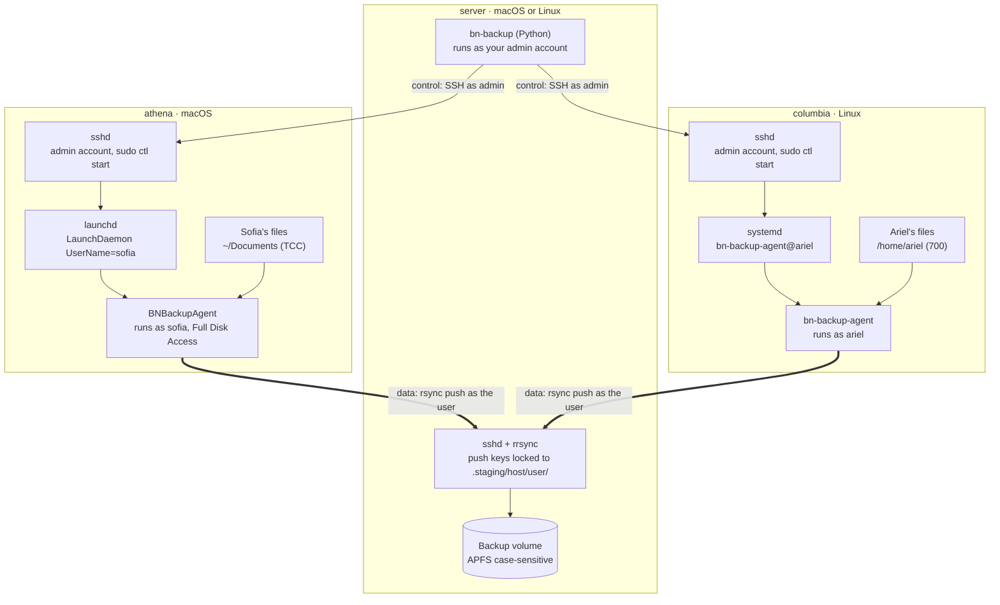
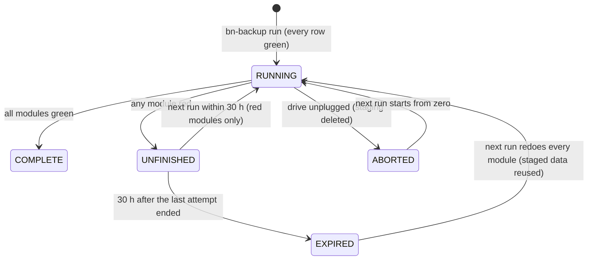

# bleiben Backup Orchestrator v2 — Design

Design approved 2026-11-10; D-55 to D-57 added 2026-11-11. The living version of this document is the "Backup Orchestrator v2 — Design" doc in claude.ai; this file is a snapshot for the repository at github.com/bleiben-labs/backup-orchestrator.

## 1. Overview

**bleiben Backup Orchestrator** v2 is a local backup system built first for photographers. It backs up chosen folders from every Mac and Debian-based Linux computer at home onto one central server: an always-on Mac or Linux computer with an external drive. Each computer runs a small **agent** that reads its own users' files, so macOS privacy protection no longer blocks the backup. You control everything from your desk.

This document explains the design in full for someone new to backup systems. Every term is explained in section 2 before it is used heavily. Section 18 lists every decision in one table, so an implementer can check nothing is left open.

### Why it exists

Backup Orchestrator started in 2018 for one job: keeping a photographer's work safe. For a photographer, the photo archive *is* the body of work. A lost drive can mean years of shoots that cannot be taken again. v2 keeps that purpose and fixes what stopped the original from working on modern macOS.

### Who it is for

- **Photographers first:** people with large photo and video archives, often spread over several computers and external drives, who want a reliable copy at home that they control.
- **Anyone else who wants a local backup:** families and small studios with a few Macs and Linux machines. Nothing in the design is limited to photos.

It is a **local** backup. Cloud services already cover off-site copies well, and this tool does not try to replace them. A local copy is faster to restore and stays under your control. The common **3-2-1 rule** (three copies, on two kinds of storage, one off site) still applies, so photographers should also keep a copy of the backup drive somewhere else.

### What photography changes in the design

| Photographers' reality | What the design does |
| --- | --- |
| Libraries of several terabytes; the first backup can take a day or more | No overall time limit on a backup job by default. Only a transfer that *stalls* is stopped (D-38) |
| A long first backup may be interrupted and resumed days later | An expired run still reuses the data already copied, so nothing is transferred twice (D-39) |
| Archives live on external drives, not only in home folders | External drives are normal backup sources. If a photo drive is not connected, the backup does not start. If it is pulled out during a run, the run is aborted and the next one starts from zero (D-40, D-45, D-46) |
| Catalogs (Lightroom Classic, Capture One, Apple Photos) are databases that change while the app is open | Close the photo app before a backup. Detecting open catalogs automatically is future scope (section 17) |
| An accidental delete or overwrite of finished work | Mirror stays the default, but snapshot mode is recommended for photographers: it keeps earlier versions (section 2) |
| Silent file corruption ("bit rot") goes unnoticed for years | With `verify_backup` on, a run also compares the contents of every original with its backup and lists files that differ although date and size match. Nothing is overwritten; you decide which copy is good (section 8) |
| Previews and caches are huge and can be rebuilt | They can be excluded per module, for example Lightroom's `*.lrdata` preview folders (section 8) |

### Brand and home

v2 belongs to the **bleiben** brand. Its source code moves to the **bleiben-labs** GitHub organization, at `github.com/bleiben-labs/backup-orchestrator`, and releases are published there. Command names keep the `bn-` prefix (`bn-backup`, `bn-backup-agent`), and macOS identifiers keep `ar.bleiben.…`.

### License

The goal is to help people, not to make money: it is free for personal and noncommercial use, professionals who earn well from their photography pay, and nobody may turn the code into their own product to sell.

- **The license** is the standard [PolyForm Noncommercial 1.0.0](https://polyformproject.org/licenses/noncommercial/1.0.0/), unchanged. The copyright notice names Ariel Hernandez and bleiben together. Personal use, hobby and family use, schools, charities and research are free. Any commercial use needs a separate license from bleiben.
- **Commercial use includes a freelance photographer backing up paid work.** Such photographers contact bleiben through [www.bleiben.ar](https://www.bleiben.ar).
- **Free commercial licenses for small earners.** As a published guideline, freelance photographers earning less than A$80,000 a year from photography receive a commercial license free of charge. Above that, the license is paid. Every grant is confirmed in writing by email. This guideline lives in a separate policy file, `LICENSING.md`, not in the license text, so it can be adjusted without changing the license.
- **No reselling.** Without a written agreement, nobody may sell the software, include it in their own product or offer it as a service. This protects the code itself, not the idea: someone could still write a similar tool from scratch.
- **The bleiben name and logo** may not be used for other products or modified versions (`TRADEMARKS.md`).
- **rsync stays GPL.** The rsync program and the `rrsync` script that ship with the tool keep their own GPLv3 license. Each release includes their license text and the matching rsync source code, as the GPL requires.
- **Contributions:** outside contributors sign a contributor agreement first, so bleiben can keep granting commercial licenses for code that includes theirs.

This is not legal advice; the owner may want a lawyer to review `LICENSING.md` and the contributor agreement.

### What you asked for

- **A green board.** Turn the computers on, then run one check from the central computer that shows whether every host is ready.
- **No dependence on cross-user permissions.** Each user's own files are read by a process running as that user, never by another account peeking in.
- **Smooth first run.** The server reads the configuration, finds every host involved and installs whatever is needed, from your desk, without walking to another bedroom except where macOS forces it.
- **One design for macOS and Linux.** Same agent, same commands, same rules on both.
- **All or nothing.** A backup counts only when every host succeeded. A failed host leaves the last complete backup untouched, and a re-run retries only the failed parts.
- **Mirror by default, history optional.** The backup normally mirrors the source; dated snapshots can be switched on.
- **Manual by default, schedulable for others.** You run it by hand; other people can schedule it weekly and receive Email or Signal notifications.

### The household this is designed around

| Item | Detail |
| --- | --- |
| Server | Any always-on Mac (macOS 13+) or Debian-based Linux computer, with an external drive: APFS (Case-sensitive) on a Mac, Btrfs or XFS on Linux |
| Macs | Several; each has two admin accounts (you and your wife) and non-admin accounts (the kids) |
| Linux hosts | Debian-based distributions |
| Host names | Fully qualified names from a local DNS server you will run (for example `galactica.home.lan`) |
| Not backed up | The server itself, for now. Docker containers on it may be added later |

### The one manual step that cannot be removed

macOS only lets a person at the computer approve Full Disk Access. So each Mac needs one visit: the server deploys the agent remotely, and someone at that Mac ticks one box. Everything else, on every Mac and every Linux host, happens from your desk. Section 4 explains why.

## 2. Backup fundamentals

A backup is a second copy of your files, kept on a different device, so losing or breaking the first copy does not lose the data. Everything below builds on a handful of ideas.

### Source, destination and module

- **Source**: the computer and folder being copied, for example `/Users/sofia/Documents` on `athena`.
- **Destination**: where the copy goes, here a folder on the server's external drive.
- **Module**: one named source folder in the configuration, such as `sofia-documents`. Each module becomes one folder in the backup.

### Mirror versus snapshot

- **Mirror**: the backup looks exactly like the source right now. A file deleted on the source is deleted from the backup on the next run. It is simple and uses the least space, but it cannot bring back something deleted before the last run. This is the default.
- **Snapshot**: each completed backup is kept as a dated picture of that moment, which later runs never change. You can go back to last week's version. It costs more space, but much less than you'd expect, because unchanged files are stored only once (see clones, below). It is optional, with a retention limit.

### rsync

`rsync` is the standard Unix tool for copying folders efficiently. It compares source and destination and transfers only what changed. With `--delete` it also removes files that no longer exist at the source, which is what makes a mirror. Two versions matter here:

- **rsync 3.x**, the full-featured version from the rsync project. The design requires it everywhere.
- **openrsync**, a smaller rewrite that recent macOS ships at `/usr/bin/rsync`. It lacks options this design needs, so the Mac agent package brings its own rsync 3.x.

### SSH, keys and `authorized_keys`

**SSH** is the encrypted remote-login protocol. One computer (the client) logs in to another (the server) and runs commands there. rsync uses SSH to move files between machines.

Instead of passwords, SSH can use a **key pair**: a private key that stays secret on the client and a public key that is copied to the server. The server lists accepted public keys in a file called `~/.ssh/authorized_keys`. Each line there can also carry **restrictions**, for example "this key may only run rsync into this one folder". This design uses those restrictions heavily (section 13).

**Remote Login** is the macOS name for the SSH server. On Linux it is the `openssh-server` package.

### Hard links and clones

A file on disk has two parts: its data and a name pointing at the data. A **hard link** is a second name pointing at the same data. Two folders full of hard links look like two complete copies but use the space of one. Changing a file through one name changes it for both, but rsync never changes files in place. It writes a new file and swaps it in, so the other name keeps the old version. That is how many backup tools keep snapshots cheap. This design uses clones instead.

**APFS clones** (macOS) are similar: a copy that shares data blocks with the original until one side changes. Unlike a hard link, a clone is a separate file, so changing its permissions leaves the original alone. The server uses clones to prepare each new backup cheaply from the previous one (section 11 explains why not hard links).

### Staging and atomic promotion

**Staging** means building the new backup in a separate work area, not on top of the good one. Only when everything succeeded is the work area **promoted**: swapped into place by renaming folders. A **rename** within one drive is instant and cannot be half-done, which makes it *atomic*. If something fails before promotion, the last good backup is untouched.

### Daemons, agents and service managers

A **daemon** is a program that runs in the background without a window. A **service manager** starts and supervises daemons:

- **launchd** on macOS. Its jobs are described by `.plist` files. A **LaunchDaemon** lives in `/Library/LaunchDaemons` and can run as any chosen user, even when nobody is logged in. A **LaunchAgent** runs only inside a logged-in user's session.
- **systemd** on Linux. Its jobs are **units**. A **template unit** such as `bn-backup-agent@.service` can be started once per user: `bn-backup-agent@sofia`.

In this document, **agent** means the Backup Orchestrator agent program, not a LaunchAgent.

### Packages

- **`.pkg`**: the macOS installer format. Opening it runs the Installer app, which can place files anywhere and run setup scripts as administrator.
- **`.deb`**: the Debian installer format, installed with `apt`. It can also run setup scripts as root.

### Wake-on-LAN

A sleeping computer can be woken by a special network message called a **magic packet**, addressed to its network card's hardware (**MAC**) address. Section 14 covers what works and what doesn't.

## 3. The current implementation (v1)

v1 is a Python package (`bn-run-backup`, version 1.0.4) that *pulls* every module from the central computer with one rsync-over-SSH command per module. It works on Linux and for your own folders, but it cannot read other users' folders on macOS.

### How v1 works

1. `bn-run-backup -j backup.yml` reads a YAML file with a `settings` section (`backup_directory`, `verify_backup`, `resume_backup`, `dry_run`) and a `modules` section. Each module names `src_path`, `user`, `host` and `os`.
2. Modules that disappeared from the YAML since the last run are moved from `current/` to `previous/`, together with the old YAML and report.
3. For each unique `user@host`, it copies `/etc/motd`, `/etc/hosts` and the user's dotfiles (hidden files in the home folder, excluding `.Trash` and `.cache`) into `current/<user>-<host>/`.
4. For each module it runs, on the central computer: `rsync --archive --compress --delete --log-file=… user@host:<src_path> <backup_directory>/current/<module>`
5. It writes `current/backup_report.log` (successful, failed, unreachable) and copies the YAML beside it. It exits with code 1 if anything failed.

Useful pieces worth keeping: rsync exit-code explanations and hints (`command_executor.py`), the progress display, never letting one failed module stop the others, and the `current/` + `previous/` layout.

### Why it breaks on macOS

The central computer logs in over SSH and rsync reads the files remotely. On a Mac, two separate locks stand in the way:

1. **Folder ownership.** Home folders are private to their owner (permissions `700`). Logging in as an admin does not change that; only `sudo` (root) bypasses it.
2. **macOS privacy protection (TCC).** Even root is refused for Desktop, Documents, Downloads, iCloud Drive, Mail, Photos and similar, unless the program doing the reading holds **Full Disk Access**. An SSH session does not hold it by default.

The error message tells you which lock fired: `Permission denied` is lock 1, `Operation not permitted` is lock 2.

Other weak spots in v1, all fixed by the new design:

- Writing straight into `current/` means a failed run leaves a half-updated backup.
- There is no pre-flight check, no wake-up, no notifications and no install step.
- `os` and `host` are repeated on every module.
- The default config path is hard-coded to one user's home folder.

## 4. How macOS and Linux protect user files

Linux has one lock on a user's files and macOS has two. The new design gets through both by running the backup *as the file's owner* and, on macOS, *from a program that holds Full Disk Access and is started by launchd*.

### Lock 1: Unix ownership and permissions (macOS and Linux)

Every file and folder has an **owner**, a **group** and three permission sets: owner, group and everyone else. Each set says read (`r`), write (`w`) and enter/run (`x`). `ls -ld /Users/sofia` showing `drwx------` means only Sofia may enter her home folder.

- macOS creates home folders as `700` (owner only).
- Debian 12 and later also creates new home folders as `700`. Older Debian and many Ubuntu systems used `755`, readable by everyone.
- Being an **admin** (macOS) or in the `sudo` group (Linux) gives no extra read access by itself. It only lets you *ask* for root with `sudo`.
- **root** (the superuser) bypasses lock 1 entirely.

When the program reading a file runs as the file's owner, lock 1 never fires. That is why each user's backup job runs as that user.

### Lock 2: TCC, macOS privacy protection (macOS only)

**TCC** (Transparency, Consent and Control) is the system behind the "*App* would like to access files in your Documents folder" prompts. It protects Desktop, Documents, Downloads, iCloud Drive, Mail, Messages, Photos, Safari data, removable and network drives, and more. It applies **even to root** and **even to the owner**.

Three facts about TCC drive this whole design:

1. **TCC judges the program, not the user.** Permission belongs to the *responsible process*: the program at the top of the chain that started the work. Its children inherit its permission.
2. **Full Disk Access (FDA)** is the TCC permission that covers everything. It is granted to a program in *System Settings → Privacy & Security → Full Disk Access*, and it applies to that program for every user on the Mac.
3. **Only a person at the screen can grant it.** The list of grants lives in a database protected by **System Integrity Protection (SIP)**, which even root cannot modify. Companies grant FDA silently through a device-management (MDM) server; a home has none, so someone clicks once per Mac.

Which program is "responsible" depends on how the backup is started:

| How the backup starts | Responsible program | Can it read `~/Documents`? |
| --- | --- | --- |
| A user runs rsync in Terminal | Terminal | Only if Terminal has FDA or the user accepts a prompt |
| The server logs in over SSH and runs rsync (v1) | `sshd`, the SSH server | Only if *Allow full disk access for remote users* is on |
| launchd starts the agent, which runs rsync (v2) | The agent | **Yes**, once the agent has FDA |
| The server logs in over SSH and runs the agent directly | `sshd` | No; this is why the server never does that |

So the server uses SSH only to *ask launchd* to start the agent job (`launchctl kickstart`). launchd becomes the parent, the agent becomes responsible, and its FDA grant applies.

**FDA is tied to the program's code signature.** macOS remembers *which exact program* was approved by its signature. A program signed by a paid Apple Developer ID keeps its grant across updates. Our agent is not signed that way (decision D-07), so its identity is a fingerprint of the exact file. **Every new agent build loses the grant**, and someone must tick the box again on each Mac. The agent is kept small and stable to make that rare.

### Gatekeeper and quarantine (macOS only)

**Gatekeeper** blocks unsigned apps and installers with an "unidentified developer" warning, but only for files carrying the **quarantine** flag. Browsers, Mail and AirDrop add that flag; copying a file with `scp` over SSH does not. The server delivers the `.pkg` by `scp`, so it opens normally. If a warning ever appears, right-click the package and choose *Open*.

### What Linux has instead

Linux has no TCC equivalent on standard Debian desktops. Some systems add **AppArmor** or **SELinux** profiles, but they do not restrict a plain service reading a user's home folder. Running the agent as the owning user is enough.

### Side by side

| Topic | macOS | Debian-based Linux |
| --- | --- | --- |
| Home folder permission | `700` | `700` (Debian 12+), `755` on older systems |
| Privacy layer | TCC, even for root | None in a default install |
| What the agent needs | Run as the owner + Full Disk Access | Run as the owner |
| One-time manual step | Tick Full Disk Access at the Mac (the agent itself is deployed remotely) | None; installed entirely over SSH |
| SSH server | *Remote Login*, off by default | `openssh-server`, sometimes not installed |
| Service manager | launchd (`LaunchDaemon` with `UserName`) | systemd (template unit `bn-backup-agent@<user>`) |
| Keep awake during a run | `caffeinate` | `systemd-inhibit` |
| Bundled rsync | Yes, rsync 3.x inside the package | No, the `.deb` depends on Debian's `rsync` package |

## 5. New architecture

The server decides everything and the agents only execute. The server tells each agent what to copy, the agent pushes that data to the server as the file's owner, and the server checks the results and promotes the new backup only when every part succeeded.

### The components

| Component | Runs on | Language | Job |
| --- | --- | --- | --- |
| **Server** (`bn-backup`) | The server, as your own admin account | Python 3.11+ | Reads the config, installs and checks agents, starts jobs, stages, promotes, reports, notifies |
| **Agent** (`bn-backup-agent`) | Every source Mac and Linux host | Rust, one codebase | Runs rsync as one user, pushing to the server; answers probes |
| **launchd / systemd** | Every source host | Built into the OS | Starts the agent as the right user, with the right privacy context |
| **sshd + rrsync** | The server | OpenSSH + rsync's `rrsync` script | Accepts pushes, locks each agent key to its own staging folder |
| **Backup volume** | External drive on the server | APFS (Case-sensitive) on a Mac; Btrfs or XFS on Linux | Holds `current/`, `removed/`, staging, state and snapshots |

### Two kinds of SSH connection

1. **Control** (server → host). The server connects to each host's **admin account** (you or your wife) with its own key. On the host that key is locked: it can only run the agent's `ctl` commands, which a narrow sudoers rule allows without a password. It writes job files, starts jobs and reads results. No user data travels on this connection.
2. **Data** (agent → server). The agent, running as the owning user, runs rsync over SSH to your account on the server. It uses a key generated for that one user on that one host. On the server, that key can only run `rrsync` into `.staging/<host>/<user>/`.

### One run, in brief

1. The server takes a lock and loads or creates the run state.
2. It checks every host (wake, reach, probe) and does not start unless all are ready. Section 10 describes the checks.
3. For each module still to do, it prepares a staging copy cheaply from `current/` using APFS clones.
4. For each `user@host` with work, it writes a job file and asks launchd or systemd to start that user's agent job.
5. Each agent pushes its modules into staging and writes a result file.
6. The server collects results. If every module is green, it promotes staging into `current/`: status **COMPLETE**. Otherwise status is **UNFINISHED**, and the next run within 30 hours retries only the red modules.
7. It writes the report and sends notifications.

The diagram below shows which machine talks to which and as whom.



Grey arrows are control: the server logs in as the admin account and asks launchd or systemd to start a job. Coloured arrows are data: each agent, running as the owning user, reads that user's files and pushes them into its own staging folder on the server.

## 6. The agent

The agent is one small Rust program, `bn-backup-agent`, built for macOS and Linux from the same code. It has no network listener and no schedule of its own. It does exactly what a job file tells it, as exactly one user, and writes down what happened.

### Why thin and why Rust

- **Thin**: on macOS every new build loses Full Disk Access (section 4). Keeping all decisions on the server means the agent rarely needs to change.
- **Rust**: it compiles to one self-contained file with no runtime to install. A stock Mac has no usable Python, so a Python agent would need a bundled interpreter.
- **Versioned protocol**: job and result files carry a `protocol` number. A newer server keeps working with older agents within a supported range, so a server update rarely forces an agent update.

### Where it lives

| Item | macOS | Linux |
| --- | --- | --- |
| Program | `/Applications/BNBackupAgent.app/Contents/MacOS/bn-backup-agent` | `/usr/bin/bn-backup-agent` |
| Command-line link | `/usr/local/bin/bn-backup-agent` | (same as program) |
| Bundled rsync 3.x | `/Applications/BNBackupAgent.app/Contents/Resources/rsync` | none; uses Debian's `/usr/bin/rsync` |
| Agent home | `/Library/Application Support/BNBackupAgent/` | `/var/lib/bn-backup-agent/` |
| Per-user job runner | LaunchDaemon `/Library/LaunchDaemons/ar.bleiben.bn-backup-agent.<user>.plist` with `UserName=<user>` | systemd template unit `bn-backup-agent@<user>.service` with `User=%i` |
| Passwordless control rule | `/etc/sudoers.d/bn-backup-agent` | `/etc/sudoers.d/bn-backup-agent` |

On macOS the program sits inside an app bundle so it appears as **BNBackupAgent** in the Full Disk Access list.

Inside the agent home:

- `agent.toml`: server address and port, server account name, admin account name. Owned by root.
- `server_known_hosts`: the server's SSH host key, pinned at setup so the agent only pushes to the real server.
- `users/<user>/job.json`: the current job, written by root, readable by the user.
- `users/<user>/state/`: owned by the user, private (`700`). It holds that user's push key `id_ed25519`, `result.json` and rsync logs.

### Two halves: `ctl` and `run`

**`ctl`** is the control half. The server calls it over SSH, and on the host it runs as root through `sudo`. It never reads user data.

| Command | What it does |
| --- | --- |
| `ctl setup` | Writes `agent.toml`, the pinned server key, the sudoers rule, the locked control-key line and Wake-on-LAN settings. Run once, by you, during bootstrap |
| `ctl info` | Prints JSON: agent version, protocol range, OS, CPU, hostname, network MAC addresses, rsync version, which users are set up and whether a job is running |
| `ctl user-add <user>` | Creates that user's folders and push key (owned by that user) and, on macOS, the per-user job; prints the public key |
| `ctl user-remove <user>` | Removes that user's job and files (manual clean-up only) |
| `ctl submit <user>` | Reads a job from standard input, validates it, writes `job.json`, deletes any old `result.json` |
| `ctl start <user>` | Asks launchd (`launchctl kickstart`) or systemd (`systemctl start`) to start that user's job |
| `ctl result <user>` | Prints `result.json`, or "not ready" |
| `ctl stop <user>` | Stops that user's running job (used on timeout or Ctrl-C) |
| `ctl log <user> <module>` | Prints the end of that module's rsync log, so the server can keep it with the run |
| `ctl open-fda-settings` | macOS: opens the Full Disk Access settings on the logged-in user's screen |
| `ctl uninstall` | Removes everything the agent installed, including the control-key line. Run by you, with your password |
| `ctl ping` | Answers "ok"; used to test the control connection |
| `ctl ssh-dispatch` | The only thing the control key is allowed to run: it accepts a `ctl` command from the server and refuses everything else |

**`run`** is the working half. Only launchd or systemd starts it, as the user, with the right privacy context. It:

1. reads `job.json`;
2. keeps the computer awake (`caffeinate` on macOS, `systemd-inhibit` on Linux);
3. for a **probe** job: tests Full Disk Access by reading a TCC-protected system file, tests each module folder for readability, and reports the error type;
4. for a **backup** job: runs rsync for each module in order, pushing to the server's staging folder for that module;
5. writes `result.json` with one entry per module: `ok` or `failed`, the rsync exit code, the error type (`permission`, `tcc`, `missing`, `drive_missing`, `source_empty`, `server_denied`, `network`, `stalled`, `timeout`, `skipped`, `other`) and transfer stats.

A module failure never stops the next module, exactly as in v1.

### The rsync command the agent runs

For each module, roughly:

`rsync --archive --hard-links --delete --numeric-ids --xattrs -M--fake-super --timeout=600 --log-file=<state>/rsync-<module>.log -e "ssh -i <key> -o UserKnownHostsFile=<agent home>/server_known_hosts -o StrictHostKeyChecking=yes -p <port>" <src_path> <your account>@<server>:<module>/`

- `<src_path>` has no trailing slash, exactly as in v1, so the folder itself lands inside the module: `/Users/sofia/Documents` becomes `current/sofia-documents/Documents/`. Keeping this means your v1 backup lines up file for file.
- No `--compress`: on a home network it only slows down the server.
- `-M--fake-super` tells the *server's* rsync to store each file's original owner, group and permissions in extended attributes. The server account is not root, so it cannot set real owners.
- `--xattrs` keeps macOS metadata such as Finder tags. `--timeout` stops a transfer that makes no progress. `--partial` is added when `resume_backup` is on, and `--dry-run` for a dry run. With `verify_backup` on, a second, report-only pass compares file contents (section 8).
- The destination path `<module>/` is relative to the folder `rrsync` locks the key into: `.staging/<host>/<user>/`.

## 7. The server

The server is the Python program `bn-backup`, the successor of v1's `bn-run-backup`. It holds all the logic: inventory, installation, checks, staging, promotion, reports, notifications and scheduling.

### Which account runs the server

The server runs as your own admin account on the server. There is no separate backup account.

- You install and run `bn-backup` as yourself. `sudo` is needed for one thing only: installing or removing the schedule.
- Agents push to your account on the server. Their keys are locked to `rrsync`, so they cannot open a shell or read anything.
- The server's control key lives in your `~/.ssh/` as `bn-backup_ed25519`, separate from your personal keys.
- The backup folder belongs to you, so you can open it in Finder and restore files directly.

The price of this simplicity is less isolation: the backup is exactly as protected as your account on the server. Keep its password strong and its disk encrypted (FileVault on a Mac).

`bn-backup server init`, run once, creates the control key, a config template and the folder layout on the backup drive, adopts an existing v1 backup, and checks the drive (section 12).

### Commands

| Command | What it does |
| --- | --- |
| `bn-backup server init` | One-time server setup (above) |
| `bn-backup server status [--json]` | Only the server rows of the board: drive, free space, rrsync, lock, config |
| `bn-backup config validate` | Checks the config file and prints every problem found |
| `bn-backup config migrate OLD.yml [-o NEW.yml]` | Detects the file's format version and converts it to the current one (today: v1 → v2) |
| `bn-backup config show [--json]` | Prints the effective config, with every default filled in; read-only |
| `bn-backup hosts list` | Shows hosts from the config and what the server knows about each |
| `bn-backup hosts add HOST` | Asks for the address, admin account and SSH port, writes the host into the config (keeping your comments), then runs `hosts bootstrap HOST` |
| `bn-backup hosts bootstrap [HOST]` | First-time setup of a new host (section 9); with no host, every host not yet set up |
| `bn-backup hosts configure [HOST]` | Re-applies users, keys and settings to an installed agent; run it after adding a new user to the config |
| `bn-backup hosts remove HOST` | Uninstalls the agent on that host, then does `hosts forget`. Refuses while the host is still in the config |
| `bn-backup hosts forget HOST` | Removes the host's push keys and server-side record only; does not touch the host |
| `bn-backup agent upgrade [HOST]` | Installs the agent version matching the server |
| `bn-backup agent status [HOST] [--json]` | Only the host rows of the board, optionally for one host |
| `bn-backup status [--json]` | The whole board: server and every host (section 10) |
| `bn-backup run [--dry-run] [--fresh] [--no-wake]` | A backup run (section 11); `--dry-run` changes nothing; `--fresh` deletes everything in staging and starts over |
| `bn-backup runs list [--limit N] [--json]` | Past runs, newest first: ID, status, attempts, green/total modules, times |
| `bn-backup runs show RUN_ID [--json]` | One run in detail: every module, its result and the reason for any red |
| `bn-backup runs cancel` | Stops the run in progress. It ends UNFINISHED, exactly as if you had pressed Ctrl-C |
| `bn-backup schedule install …` / `remove` / `show` | Scheduled runs (section 15) |
| `bn-backup notify test` | Sends a test Email and Signal message |
| `bn-backup notify set-smtp-password` | Asks for the email app password and stores it in a private file only you can read |

Commands are grouped by the thing they act on (`server`, `config`, `hosts`, `agent`, `runs`, `schedule`, `notify`), then the action. `status` and `run` stay short because they are used most.

### Exit codes

| Code | Meaning |
| --- | --- |
| 0 | COMPLETE, or a dry run that found no problems |
| 1 | Nothing was attempted: a usage or configuration error, or NOT STARTED because the server or a host was not ready |
| 2 | UNFINISHED: some modules are red; re-run within 30 hours |
| 3 | Another run is already in progress |
| 4 | ABORTED: a drive was unplugged during the run; everything staged was deleted |

### Installing the server

The server is a Python package released with every version. You install it in your own account on the server with `uv tool install`. A Mac server also needs Homebrew's `rsync` 3.x and, for Signal, `signal-cli`. The `rrsync` script ships inside the server package and is pointed at Homebrew's rsync, because macOS's own `/usr/bin/rsync` is openrsync. On a Linux server it uses Debian's `/usr/bin/rsync`.

## 8. Configuration file

The configuration stays a single YAML file, now in a v2 format with separate `server`, `settings`, `notifications`, `hosts` and `modules` sections. Hosts are described once and modules refer to them. The file is the only thing you edit by hand. Everything the server learns (OS, MAC addresses, installed agent version) is stored separately under `.state/`.

Default location: `~/.config/bn-backup/config.yml` in your home folder on the server (mode `0600`), overridable with `-c PATH`. You edit it with any editor, and `bn-backup hosts add` can update it too. It holds no secrets: the email password lives in a separate file that `bn-backup notify set-smtp-password` writes for you.

```yaml
version: 2

server:
  backup_directory: /Volumes/Backup/bn-backup   # on the APFS (Case-sensitive) drive
  ssh_host: server.home.lan                    # how agents reach the server
  ssh_port: 22
  receive_user: ariel                           # your account on the server

settings:
  mode: snapshot             # mirror (default) | snapshot (recommended for photographers)
  snapshot_keep: 8           # snapshot mode: completed backups to keep
  verify_backup: false       # extra pass: compare contents and report differences (slow)
  resume_backup: true        # rsync --partial
  dry_run: false
  host_config_backup: true   # /etc/hosts, /etc/motd and dotfiles per user@host
  unfinished_ttl_hours: 30   # hours after the last attempt ended
  max_parallel_hosts: 2
  job_timeout_minutes: 0     # 0 = no overall limit (multi-terabyte first backups)
  io_timeout_seconds: 600    # stop a transfer that makes no progress for 10 minutes
  min_free_gb: 50
  wake:
    enabled: true
    wait_seconds: 180

notifications:
  email:
    enabled: true
    smtp_host: smtp.gmail.com
    smtp_port: 587
    starttls: true
    username: you@example.com
    password_file: ~/.config/bn-backup/smtp_password   # mode 600
    from: you@example.com
    to: [you@example.com]
  signal:
    enabled: true
    signal_cli: /opt/homebrew/bin/signal-cli
    account: "+61400000000"      # your number, linked as a device
    note_to_self: true
    recipients: []

hosts:
  galactica:
    address: galactica.home.lan
    admin_user: ariel
    ssh_port: 22
  athena:
    address: athena.home.lan
    admin_user: ariel
  columbia:
    address: columbia.home.lan
    admin_user: ariel

modules:
  ariel-photo-archive:                     # RAW archive on an external drive
    host: galactica
    user: ariel
    src_path: /Volumes/PhotoArchive/Photos
  ariel-lightroom:                         # catalog folder; close Lightroom before a run
    host: galactica
    user: ariel
    src_path: /Users/ariel/Pictures/Lightroom
    excludes: ["*.lrdata"]                 # previews: large and rebuilt by Lightroom
  sofia-documents:
    host: athena
    user: sofia
    src_path: /Users/sofia/Documents
    excludes: [".DS_Store"]
  ariel-exports:
    host: columbia
    user: ariel
    src_path: /home/ariel/exports
```

(The names, email and phone number above are placeholders.)

### Modules for photo work

- **One module per archive.** A RAW archive, a catalog folder and an exports folder each make a good module. Smaller modules retry faster when something goes wrong.
- **External drives are fine.** Use the drive's path, for example `/Volumes/PhotoArchive/Photos` on a Mac or `/media/ariel/PhotoArchive` on Linux. The drive must be connected before a run: if it is not, the backup does not start and tells you which drive to connect. The check looks for the mounted drive, not just a folder with the right name, and a backup that holds data is never replaced by an empty folder (D-55). Never unplug a drive during a run (see "When a drive is unplugged" in section 11).
- **Catalogs:** back up the whole catalog folder, and close the photo app first. Lightroom's `*.lrdata` folders hold previews that Lightroom rebuilds, so excluding them saves a lot of space. Remove the exclude if you want previews kept too.
- **Apple Photos:** the library (`~/Pictures/Photos Library.photoslibrary`) is a single folder package and backs up like any folder. Quit Photos first. With *Optimize Mac Storage* on, originals live only in iCloud (section 17).
- **Snapshot mode** keeps the last `snapshot_keep` complete backups. If a photo is deleted or overwritten by mistake, an older snapshot still has it. Mirror mode would delete it from the backup at the next run.
- **Checking for silent corruption:** set `verify_backup: true` now and then. After copying, the run compares the contents of every file with its backup. Files that differ although their date and size match are listed in the report and the notification, and nothing is overwritten. One of the two copies is damaged: open both and keep the good one. It reads every file on both sides, so expect hours for a large archive.

### Validation rules

`bn-backup config validate` and every command refuse a config that breaks any of these:

- `version` must be `2`.
- Every module's `host` must exist under `hosts`.
- Module names: letters, digits, `-` and `_` only, unique across the whole file.
- A module name must not equal a generated host-config name `<user>-<host>`, and two `user@host` pairs must not generate the same name.
- `src_path` must be absolute and must not end in `/`.
- Host `address` must be a fully qualified name (`galactica.home.lan`), a `.local` name (`galactica.local`) or an IP address. A bare name such as `galactica` is refused (decision D-18).
- `mode` must be `mirror` or `snapshot`; numbers must be whole numbers in their allowed range (for example `snapshot_keep` at least 1, `io_timeout_seconds` at least 30; `job_timeout_minutes: 0` means no limit).
- Unknown keys are errors, not warnings, so typos are caught.

### What is no longer in the file

- `os` per module: the server detects it at bootstrap.
- `user@host` repeated per module: hosts are listed once.
- MAC addresses: the agent reports them.

`bn-backup config migrate OLD.yml` turns a v1 file into this format. It groups modules by host, takes `admin_user` from the module's `user` as a starting guess, and flags each guess for you to check.

## 9. First-time setup and adding a host

One command, `bn-backup hosts bootstrap`, sets up every host in the config that is not set up yet. You type each host's admin password at your desk. On a Mac, someone then ticks Full Disk Access once at that Mac. Linux hosts need nothing at the machine.

### Before you start (one time each)

**On the server (a Mac):**

1. Format the backup drive as **APFS (Case-sensitive)** and name it, for example `Backup`.
2. Make sure the drive does not have *Ignore ownership on this volume* ticked (Finder → Get Info).
3. Turn on *System Settings → General → Sharing → Remote Login*, and inside its ⓘ turn on **Allow full disk access for remote users**. Agents' pushes arrive through SSH and write to an external drive, which macOS protects.
4. Install Homebrew, then `brew install rsync signal-cli` and `uv`.
5. Install the server in your own account (`uv tool install <wheel link from the GitHub release>`) and run `bn-backup server init`.

**On a Linux server instead:** format the backup drive as Btrfs or XFS (clone support is required), `sudo apt install rsync openssh-server`, install `uv` (and `signal-cli` for Signal), then step 5.

**On each source Mac:** turn on *Remote Login* and allow your admin account to use it. Nothing else.

**On each Linux host:** make sure `openssh-server` is installed and running, and that your admin account can use `sudo`.

**On your network:** the server must be able to resolve every host's `address`, and every host must resolve the server's `ssh_host`. A local DNS server or `.local` names both work. Macs resolve `.local` names out of the box; Debian-based hosts need the `avahi-daemon` and `libnss-mdns` packages for that.

### What bootstrap does, per host

1. **Reach it.** Resolve the name and check that SSH answers. Red if either fails.
2. **Log in as you.** For the set-up steps the server opens an ordinary SSH login to the host's admin account, so you type that account's password (or your own SSH key is used). The server's control key is not involved yet.
3. **Detect the OS and CPU** (`uname`). Stored in `.state/hosts/<host>.json`.
4. **Check the users.** Every `user` named in that host's modules must exist there. Red otherwise.
5. **Install the agent**, matching the server's version:
   - **Linux:** copy the `.deb` and run `sudo apt-get install -y ./bn-backup-agent_<version>_<arch>.deb`. You type the sudo password once.
   - **macOS:** copy the `.pkg` to `/Users/Shared/` and run `sudo installer -pkg … -target /`. You type the admin password once. The package stays in `/Users/Shared/` in case someone prefers to install it by hand.
6. **Set up the agent:** `sudo bn-backup-agent ctl setup` with the server address, port and pinned host key, the admin account name and the server's control key. This installs the passwordless sudoers rule and adds the control key to the admin account in locked form: from now on that key can run the agent's `ctl` commands and nothing else.
7. **Add each user:** through the control key, `ctl user-add <user>` creates the user's job and push key. The server adds that public key to your `authorized_keys` on the server, locked to `rrsync` and `.staging/<host>/<user>/`.
8. **macOS only, grant Full Disk Access.** The server opens *Privacy & Security → Full Disk Access* on that Mac's screen, if someone is logged in, and prints: *Go to athena and switch on BNBackupAgent*. An admin types their password there to approve. The server polls with probe jobs and continues as soon as the probe reports Full Disk Access granted.
9. **Read the host's details** (`ctl info`): MAC addresses, rsync version, agent version.
10. **Probe.** One probe job per user checks every module folder. The host ends green or red on the board.

Bootstrap can be re-run safely. Each step checks first and skips what is already done.

### Adding a host or user later

There are two equal ways to add a host:

- **Edit the config** and add the host under `hosts:`, then run `bn-backup hosts bootstrap HOST`.
- **Run `bn-backup hosts add HOST`.** It asks for the address, admin account and SSH port, writes them into the config for you, keeping your comments and layout, and starts the bootstrap. Add the host's modules to the config afterwards.

A new *module* for a user who is already backed up needs nothing more. A new *user* on a known host needs `bn-backup hosts configure HOST`, which adds that user's job and key. Until you run it, the board shows that row red and a run does not start. No Full Disk Access click is needed, because the grant covers every user on that Mac.

### Removing something

- **Stop backing something up:** delete it from the config. Its modules move to `removed/` at the next COMPLETE run. The agent stays installed.
- **Remove a host completely:** delete it from the config, then run `bn-backup hosts remove HOST`. The host must be reachable: the server uninstalls the agent there (you type the admin password), then forgets its keys and record.
- **Forget a host you can no longer reach** (sold, broken): `bn-backup hosts forget HOST`. It only cleans up the server's side.

## 10. The status board

`bn-backup status` answers one question: *if I ran a backup now, would it start and succeed?* It shows one row per `user@host` plus one row for the server, each green or red with the reason. It is read-only: it never changes a backup, the config or a host's set-up. It only wakes sleeping hosts and runs harmless probes (each probe writes one tiny test file into that user's staging folder). `run` performs the same checks first and does not start unless every row is green.

### Server checks

| Check | Green when |
| --- | --- |
| Volume mounted | `backup_directory` exists and is on a mounted volume |
| Case-sensitive | The volume is APFS (Case-sensitive) |
| Ownership | *Ignore ownership* is off |
| Free space | At least `min_free_gb` free |
| Drive writable | `run` and `server init` create, clone and delete a test file on the drive; `status` only checks write permission, so it stays read-only |
| rrsync | Found and runnable |
| No other run | No live run lock (kept on the server's internal disk) |
| No interrupted promotion | No half-finished promotion is waiting (the next `run` finishes it) |
| Config | Valid |

### Host and user checks, in order

A row stops at its first failure; later columns show "–".

| Check | How | Red means |
| --- | --- | --- |
| Name resolves | DNS lookup of `address` | Fix DNS or the config |
| Reachable | The SSH port answers within 10 seconds | Asleep after wake attempt, off, or offline |
| Agent installed | `ctl info` answers through the control key | Run `hosts bootstrap` |
| Agent version | Protocol inside the server's supported range | Run `agent upgrade` |
| User set up | `ctl info` lists that user | Run `bn-backup hosts configure HOST` |
| No leftover job | No job from an earlier run is still running for that user | `run` stops it first; red only if it will not stop |
| Full Disk Access (macOS) | Probe job, started by launchd as that user | Tick BNBackupAgent in Full Disk Access on that Mac |
| Module folders | Probe reads each `src_path` | `missing`, `drive_missing` (external drive not connected), `source_empty` (folder empty but its backup is not), `permission` or `tcc`, per folder |
| Server reachable from host | Probe writes a small test file to the server with the user's push key | Network, DNS or key problem; or the server refused the write: on a Mac server, turn on *Allow full disk access for remote users* there; check the drive is not read-only |

The probe is a real job started through launchd or systemd, exactly like a backup. That matters on macOS: testing over SSH would test the SSH server's privacy context, not the agent's, and could report green when a backup would fail.

### Extra columns

- **Last complete**: when this `user@host` was last part of a COMPLETE run.
- **Pending**: during an UNFINISHED run, how many of this row's modules still need to be redone, and how many hours remain before the run expires.

While a run holds the lock, `status` does not probe hosts. It shows the run's progress from `.state/run.json` instead, so it never disturbs a backup.

`--json` prints the same data for scripts.

## 11. A backup run

A run only starts when the server and every host are ready, and it only changes `current/` when every module of every host has succeeded. If some modules fail, the work stays in staging, the run is **UNFINISHED**, and a re-run within 30 hours of the end of the last attempt redoes only the red modules. After that the run is **EXPIRED** and the next run redoes every module, reusing the data already copied. If a drive is unplugged during a run, the run is **ABORTED** and everything staged is deleted, as if the backup had never happened.

### Run statuses

| Status | Meaning | What the next `bn-backup run` does |
| --- | --- | --- |
| `RUNNING` | A run is in progress and holds the lock | Exits with code 3 |
| `UNFINISHED` | At least one module is red. Green modules stay in staging | Within the time limit: redoes only red modules |
| `COMPLETE` | Every module green and staging promoted into `current/` | Starts a new run |
| `EXPIRED` | An UNFINISHED run not completed within `unfinished_ttl_hours` (30) of the end of its **last** attempt | Starts a new run that redoes every module, reusing the data already in staging so nothing is copied twice |
| `ABORTED` | A drive was unplugged during the run: the backup drive on the server, or a photo drive on a host. Everything in staging was deleted | Starts a new run from zero |

The status is decided by the server when a run ends. An UNFINISHED run past its time limit is shown as EXPIRED by status and recorded as EXPIRED by the next run. A run whose server process died without finishing (power cut, Ctrl-C) leaves a lock whose process no longer exists. The next command treats it as UNFINISHED with the interrupted modules red.



An UNFINISHED run loops back into RUNNING for its red modules only, until it is COMPLETE or 30 hours have passed since its last attempt ended. A drive unplugged mid-run ends the run as ABORTED.

### What counts as a module

Each config module is one unit of work, retried on its own. With `host_config_backup: true`, each `user@host` also gets a generated module named `<user>-<host>` holding `/etc/hosts`, `/etc/motd` and the user's dotfiles (excluding `.Trash` and `.cache`), as in v1.

A module is **green** when the agent reported rsync exit code 0, or 24 ("some files vanished during transfer"): files disappearing while being copied is normal on a live system. Every other outcome is red: any other exit code, a stalled transfer, a host that drops off the network mid-run or a timeout.

### Step by step

1. **Lock.** Take the run lock, kept on the server's internal disk so that a missing backup drive is reported as NOT STARTED, not mistaken for a run in progress. If a live lock exists, exit 3.
2. **Load state.** Finish any clean-up left by an aborted run (see "When a drive is unplugged" below). Read `.state/run.json`. If it is UNFINISHED and past its time limit, mark it EXPIRED and record it in the run history. Its staging folders stay: the new run sends every module again, and rsync only transfers what differs from what is already there. If it is UNFINISHED and in time, *resume* it. Otherwise prepare a new run with a new `run_id` (date and time, for example `20261110-213000`).
3. **Work list.** New run: every module. Resumed run: only modules not green.
4. **Wake and check.** For each host with work, run the status checks (section 10), sending Wake-on-LAN first if it is unreachable. If any row is red (a host is unreachable, Full Disk Access is missing, a photo drive is not connected), the run is **NOT STARTED**: nothing is copied, an UNFINISHED run stays exactly as it was, the board and a notification say what to fix, and the exit code is 1.
5. **Prepare staging.** For each module to run, if `.staging/<host>/<user>/<module>/` does not exist yet, create it as an APFS clone of `current/<module>/` (macOS `clonefile`, which clones a whole folder tree in one step), or empty if there is no `current/<module>/`. A clone costs almost no space, and rsync then transfers only changes.
6. **Run jobs.** For up to `max_parallel_hosts` hosts at a time, and for each user on the host, one after another: `ctl submit` a backup job listing that user's modules, `ctl start`, then poll `ctl result` every 10 seconds until the job is done. A transfer that makes no progress for `io_timeout_seconds` (10 minutes) is stopped and its module turns red. `job_timeout_minutes` adds an overall limit if you want one; by default (0) there is none, because a first backup of a large photo library can take more than a day. Record each module's result in `run.json` as it arrives. If a job stops without reporting (the host restarted, for example), its modules turn red instead of the server waiting forever. While jobs run, the server also checks every 10 seconds that the backup drive is still there.
7. **Decide.** All modules green: promote (next section) and mark COMPLETE. Otherwise mark UNFINISHED and record when this attempt ended; the 30-hour limit counts from that moment.
8. **Report and notify.** Write the report (section 12) and send notifications (section 15).
9. **Unlock.**

With `--dry-run` (or `dry_run: true`), nothing is changed anywhere: no staging is created or deleted, no run is recorded and no notification is sent. The one exception is the tiny test file each probe writes (D-56). The server runs every check, then asks each agent to run rsync with `--dry-run` against whatever is already in staging. You learn whether every module would run; transfer sizes are not reported.

`--fresh` deletes everything in `.staging/` and starts a new run, but only once every check has passed: if the run does not start, nothing is deleted (D-57). It never touches `current/`, snapshots or `removed/`.

### When a drive is unplugged

A drive disappearing in the middle of a run is treated as critical, because nobody can be sure what was copied. Two cases count:

- **The backup drive on the server** is unplugged or unmounts.
- **A photo drive on a host** (a module on an external drive) disappears while its job is running.

In both cases the server:

1. stops every job on every host at once;
2. marks the run **ABORTED**, recording which drive on which machine caused it;
3. deletes everything in `.staging/`, including modules that had already finished, so it is as if the backup never happened;
4. sends an ABORTED notification and exits with code 4.

`current/` is never touched, so your last complete backup is safe. The next `bn-backup run` starts from zero.

If it was the backup drive that vanished, the server cannot clean it or write to it. It leaves a note on the server's internal disk instead. After the drive is plugged back in, `status` shows "clean-up pending", and the next `run` finds the note, deletes `.staging/`, records the run as ABORTED and only then continues.

A drive that is simply not connected *before* a run is not an abort: the run does not start (step 4), and there is nothing to clean.

### Promotion

Promotion turns staging into the new `current/`, one module at a time, by renaming folders on the same drive. Each rename is instant. A small journal, `.state/promotion.json`, lists every step before any is taken and marks each one done. If the server crashes in the middle, the next `bn-backup run` finishes the remaining steps first, including marking the run COMPLETE, and `status` shows "promotion interrupted" until then.

For each module:

1. **Mirror mode:** rename `current/<module>` to `.trash/<run_id>/<module>`. **Snapshot mode:** rename `current/<module>` to `snapshots/<completion time of the backup being replaced>/<module>`.
2. Rename `.staging/<host>/<user>/<module>` to `current/<module>`.

Then:

3. Move module folders that are in `current/` but no longer part of the backup to `removed/`, with the old config and report. This is v1's `previous/` folder under a clearer name. The generated host-config folders are part of the backup and stay.
4. Copy the config to `current/` and write `current/backup_report.log`.
5. Delete `.trash/`. In snapshot mode, delete the oldest snapshots beyond `snapshot_keep`.
6. Mark the run COMPLETE and record its completion time.
7. Delete the journal and what is left of `.staging/`.

### Why a clone and not hard links

rsync changes a file's *metadata* (permissions, extended attributes) in place without rewriting it. With hard links, that change would also hit the file in `current/` before promotion, breaking the "nothing changes until all green" promise. An APFS clone is a separate file that only shares data blocks, so it is safe. Snapshot mode keeps space low the same way: each snapshot shares unchanged data with the next.

## 12. Storage layout on the server

The v1 layout stays: the last complete backup is in `current/<module>/`. Modules removed from the config go to `removed/` (v1 called it `previous/`; `server init` renames an existing one). Your existing v1 backup becomes the starting point, so the first v2 run transfers only changes. New work folders start with a dot so they stay out of the way.

```
<backup_directory>/
├── current/                      last COMPLETE backup (v1 layout, unchanged)
│   ├── <module>/<folder name>/   e.g. sofia-documents/Documents/
│   ├── <user>-<host>/            host config: hosts, motd, <user>/ dotfiles
│   ├── config.yml                the config used for this backup
│   └── backup_report.log
├── removed/                      modules removed from the config (v1: previous/)
├── snapshots/                    snapshot mode only
│   └── 20261103-213000/<module>/
├── .staging/                     the run in progress
│   └── <host>/<user>/<module>/   one agent key can write only inside its <host>/<user>/
├── .trash/                       mirror mode, during promotion only
├── .state/
│   ├── run.json                  the current or last run, with every module's result
│   ├── promotion.json            only while a promotion is in progress
│   ├── hosts/<host>.json         detected OS, CPU, MAC addresses, agent version
│   ├── keys/<host>/<user>.pub    each agent's push key
│   ├── last_complete.json        when the last COMPLETE run finished
│   ├── last_report.log           report of the last run, complete or not
│   └── history/<run_id>.json     one file per finished run
└── logs/
    └── <run_id>/<host>-<user>-<module>.log   rsync logs copied back from agents
```

### Drive requirements and why

| Requirement | Why |
| --- | --- |
| APFS | Clones make staging and snapshots cheap; renames are atomic |
| Case-sensitive | Linux allows `Notes.txt` and `notes.txt` side by side; a case-insensitive drive would silently keep only one |
| *Ignore ownership* off | So the ownership and permissions stored on the backup drive are real |
| Mounted at boot | Scheduled runs happen without anyone logged in. An encrypted drive must be set to unlock automatically, or `status` stays red |

### How original owners and permissions are kept

The server writes as your account, so every file on the drive is *really* owned by you. The original owner, group, permissions and special file types are stored in an extended attribute on each file (rsync's `--fake-super`). When restoring with rsync and `--fake-super`, they come back exactly. Files already in `current/` from v1 have no such attribute; the first v2 run adds it with a quick metadata-only pass.

### Restoring files

In v2, restoring is done by hand: open `current/<module>/` on the server (in Finder on a Mac; the folder belongs to your account) and copy what you need. The original owners and permissions stay recorded in the backup, so a guided `bn-backup restore` command can bring them back exactly later. That command is future scope (section 17).

## 13. Security model

Every key and permission in the system can do one narrow job and nothing more. A stolen agent key can only add files to its own staging folder. The server's control key can only run the agent's control commands. No account on a host can read another user's files.

### Who can do what

| Credential | Lives on | Can log in to | Allowed to do |
| --- | --- | --- | --- |
| Server control key | Server, `~/.ssh/bn-backup_ed25519` | Each host, as its admin account | Only the agent's `ctl` commands (they run as root, without a password). No shell, no file copy, no port forwarding |
| Agent push key (one per `user@host`) | Host, `users/<user>/state/id_ed25519`, readable only by that user | Server, as your account | Only `rrsync -wo` inside `.staging/<host>/<user>/`: write and delete there, nothing else, no shell, no port forwarding |
| Server host key | Server, pinned on every host | – | Proves to agents they are talking to the real server |
| sudoers rule on hosts | `/etc/sudoers.d/bn-backup-agent` | – | Admin account may run only `bn-backup-agent ctl *` as root without a password |
| Full Disk Access | Each Mac, for BNBackupAgent | – | The agent may read protected folders, but only when launchd starts it as a backup user |

The push key's line in `authorized_keys` looks like this:

`restrict,command="/Users/ariel/.local/libexec/bn-backup/rrsync -wo /Volumes/Backup/bn-backup/.staging/athena/sofia" ssh-ed25519 AAAA… bn-backup-agent sofia@athena`

`restrict` turns off shells, port forwarding and terminals. `command=` replaces whatever the client asked to run with `rrsync`, which accepts only rsync and only inside that folder. `-wo` means write-only: the key cannot download anything, not even its own earlier backups.

The control key's line on each host is locked the same way:

`restrict,command="/usr/bin/sudo -n /usr/bin/bn-backup-agent ctl ssh-dispatch \"$SSH_ORIGINAL_COMMAND\"" ssh-ed25519 AAAA… bn-backup-server`

Whatever the server sends is handed to `ctl ssh-dispatch`, which runs it only if it is one of the agent's control commands. Installing, upgrading or removing an agent is never done with this key: the server opens an ordinary login as you, and you type the password.

### Why kids' files stay private

- The kids' agent jobs run as the kids. They read only what that child can already read.
- Each child's push key belongs to that child's account (`600`), so other users on that Mac cannot use it.
- On the server, the backups belong to your admin account and are closed to every other account on that computer.

### What a stolen key could do

The control key can start and stop backup jobs and read their results on every host. It cannot open a shell, install software or read files. The worst a thief could do with it is make a host back up a folder its user can already read, and that data would still go only to your server. The server itself matters more: whoever controls your account there has every backup. Protect it with FileVault, a strong password and automatic updates. If it is ever compromised, run `hosts remove` for every host from a clean machine, or delete the `bn-backup-server` line from each host's `authorized_keys`, then bootstrap again with a new key.

### The job file is trusted input

The agent runs whatever modules `job.json` lists, so only root may write it (`ctl submit`, behind the sudoers rule). A user cannot change their own job to back up something else, and they gain nothing by trying: their push key can still only write to their own staging folder.

### Full Disk Access is broad, and that is accepted

Full Disk Access lets BNBackupAgent read protected folders of whichever user it runs as. It never runs as a user other than the one launchd names in that user's job, and it only reads the paths in `job.json`. This is the narrowest grant macOS offers without a device-management server.

## 14. Wake-on-LAN and keeping machines awake

The server wakes sleeping hosts automatically and keeps every host awake while its backup runs. It cannot switch on a computer that is fully shut down in most cases, so "turn all the computers on" still means: not shut down.

### What can be woken

| Machine state | Mac on Ethernet | Mac on Wi-Fi | Linux PC on Ethernet | Linux on Wi-Fi |
| --- | --- | --- | --- | --- |
| Asleep | Yes | Only with a sleep proxy at home (Apple TV or HomePod) | Yes, if the network card supports it | Rarely |
| Shut down | No on Apple silicon; some Intel Macs | No | Often, if enabled in the BIOS/UEFI | No |

### How it is set up

- **The agent turns it on** during `ctl setup`:
  - macOS: `pmset -a womp 1` (*Wake for network access*).
  - Linux with NetworkManager: sets `wake-on-lan magic` on every wired connection.
  - Linux without NetworkManager: installs a systemd `.link` file with `WakeOnLan=magic` for wired interfaces.
  - A BIOS/UEFI setting may still be needed on Linux PCs; the status board cannot see it.
- **The agent reports MAC addresses** (`ctl info`) and the server stores them in `.state/hosts/<host>.json`. You never type one.

### What the server does

1. A host fails the *Reachable* check.
2. If `wake.enabled`, the server sends a magic packet for every MAC address it knows for that host, to the broadcast address on UDP ports 9 and 7.
3. It re-checks every 15 seconds for up to `wake.wait_seconds` (180).
4. Still unreachable: the row is red with "unreachable after wake attempt", and a run does not start.

`--no-wake` skips this.

### Staying awake during a backup

- **macOS:** the agent starts `/usr/bin/caffeinate -i -s -w <agent process ID>`, which prevents sleep until the agent exits.
- **Linux:** the agent holds a `systemd-inhibit --what=sleep:idle` lock for the duration of the job.
- **Server:** the server holds the same kind of lock (`caffeinate` on macOS, `systemd-inhibit` on Linux) for the whole run. Its energy settings should also prevent sleep, since it is always on.

A laptop closed and unplugged will sleep regardless. That module goes red and the next run retries it.

## 15. Scheduling and notifications

Runs are manual by default. Anyone can add a schedule on the server with one command, and the server can report every finished run by Email and Signal.

### Scheduling

`bn-backup schedule install --weekly sun --at 02:00` creates a scheduled job on the server that runs `bn-backup run` as you. Installing or removing the schedule is the one command that needs `sudo`:

- **macOS server:** a LaunchDaemon `/Library/LaunchDaemons/ar.bleiben.bn-backup.schedule.plist` with `UserName=<your account>` and a calendar interval.
- **Linux server:** a systemd service plus timer (`bn-backup-schedule.timer`).

Options: `--weekly <day>` or `--daily`, plus `--at HH:MM` in the server's local time. Only one schedule exists at a time; installing again replaces it. `schedule show` prints it and `schedule remove` deletes it.

A scheduled run behaves exactly like a manual one. If it ends UNFINISHED, the next scheduled run (a week later) is past the 30-hour limit, so it backs up every module again (reusing the data already copied). The notification tells you to re-run by hand within 30 hours if you want that run completed. If a Mac server was asleep at that time, launchd runs the backup once when it wakes. If it was switched off, that run is skipped until the next scheduled time (a Linux server's timer catches up after power-off too).

### Notifications

Sent at the end of every `run`, manual or scheduled. If the previous run had expired, the message says so. They are skipped for `--dry-run`. Each enabled channel gets the same message.

**Subject:** `[bn-backup] COMPLETE — 14/14 modules`, `[bn-backup] UNFINISHED — 2 of 14 modules red`, `[bn-backup] NOT STARTED — galactica: photo drive not connected` or `[bn-backup] ABORTED — backup drive unplugged`

**Body:** run ID, status, start and end time, time left before expiry (UNFINISHED only), and every red module with its host, user and reason. It ends with the next step, for example "Switch on BNBackupAgent in Full Disk Access on athena, then re-run before 2026-11-11 21:30."

| Channel | How it sends | Setup |
| --- | --- | --- |
| Email | SMTP with STARTTLS, using Python's standard library | An app password from your mail provider in `password_file` (mode `600`) |
| Signal | Runs `signal-cli` | `brew install signal-cli`, then link it to your phone as a secondary device once (`signal-cli link`, scan the QR code). Messages arrive in your *Note to Self* chat. Other `recipients` (phone numbers) are optional |

Signal has no official API for scripts; `signal-cli` is the standard unofficial client. If the server or a host is not ready before anything starts (for example, the backup drive is not mounted or a laptop is away), a NOT STARTED message is sent with the reason, so a scheduled run never fails silently. If a channel fails, the run's status and exit code do not change; the failure is written to the report and the log. With `verify_backup` on, files that need checking are listed in the message. `bn-backup notify test` sends a test message on every enabled channel.

## 16. Releases, packaging and updates

Every release is built by GitHub Actions from a version tag and published as a GitHub release. The server downloads the agent package matching its own version, checks its fingerprint, and installs it. A Linux host updates without anyone at the machine. A Mac needs one Full Disk Access tick after each agent update.

### Versions

- One version number for everything, starting at `2.0.0`, tagged `v2.0.0`.
- Separately, an integer **agent protocol** version, starting at `1`, in every job and result file. It changes only when the job or result format changes.
- The server declares which protocol versions it accepts. An agent outside that range shows red with "agent upgrade needed". An agent inside it keeps working even if its release version is older.

### What each release contains

| File | Built on | Contents |
| --- | --- | --- |
| `bn-backup-agent-<version>.pkg` | macOS runner | `BNBackupAgent.app`: the agent as one universal file (Apple silicon + Intel), ad-hoc signed, plus rsync 3.4.x built from source as a universal file and its GPL license and source link |
| `bn-backup-agent_<version>_amd64.deb` | Linux runner | Static agent (musl), systemd template unit; depends on `rsync (>= 3.2.3)`, `openssh-client`, `sudo` |
| `bn-backup-agent_<version>_arm64.deb` | Linux runner | Same, for ARM boards |
| `bn_backup-<version>-py3-none-any.whl` | Linux runner | The server |
| `SHA256SUMS` | – | Fingerprints of every file above |
| `rsync-3.4.1.tar.gz` | – | The exact rsync source code used for the bundled rsync and rrsync, as the GPL requires |

The `.pkg` is not signed with an Apple Developer ID (decision D-07). It is delivered by `scp`, so it carries no quarantine flag and Gatekeeper does not block it.

### How the server gets agent packages

On `bootstrap` or `agent upgrade`, the server downloads the files for its own version from the GitHub release at github.com/bleiben-labs/backup-orchestrator into `~/.cache/bn-backup/releases/<version>/`. It checks them against `SHA256SUMS` and refuses any mismatch. If GitHub is unreachable, it uses the cache. For development, `--agent-package PATH` uses a local file instead.

### Updating

1. Update the server: `uv tool install --force <link to the new wheel in the GitHub release>`.
2. Run `bn-backup status`. Hosts whose agent protocol is no longer accepted are red.
3. Run `bn-backup agent upgrade` (all hosts) or `agent upgrade HOST`.
   - **Linux:** copied and installed with sudo apt-get install over SSH. You type the admin password at your desk. Done.
   - **macOS:** copied and installed with `sudo installer` over SSH. You type the admin password at your desk. The new build has a new signature, so macOS drops the old Full Disk Access grant. The server prints which Macs need the BNBackupAgent switch turned on again, opens the setting on screen where someone is logged in, and waits for the probe to turn green.

Updating agents is needed only when the protocol changes or an agent bug is fixed. A server-only release leaves the Macs alone.

Installing packages always asks for the admin password, on purpose. The server's control key cannot install anything: it can only run `ctl` commands. A stolen control key therefore cannot put a fake agent on a host.

## 17. Limitations and future scope

These are known gaps. None blocks v2.

### Limitations

- **Strict by design.** One host that is off, or one photo drive that is not connected, keeps the whole backup from starting. Check the board (`bn-backup status`) before a run. **One visit per Mac** is also needed, plus one Full Disk Access tick after each agent update. Only a device-management server or a paid Developer ID would reduce this.
- **FileVault after a reboot.** Until someone unlocks a Mac at its login screen after a restart, it cannot be reached over SSH. Reboot Macs before a planned backup, not during it. The same applies to a Mac server: after a power cut it waits at the unlock screen, so scheduled runs resume only once someone unlocks it.
- **Shut-down machines** mostly cannot be woken (section 14).
- **iCloud Drive with *Optimize Mac Storage*.** Files stored only in iCloud are placeholders on the Mac. rsync reading them makes macOS download them first, which can be slow and fill the disk. Either turn optimization off on Macs whose iCloud folders are backed up, or exclude those folders and rely on iCloud itself.
- **Open databases.** Photo catalogs (Lightroom Classic, Capture One, Apple Photos) and other apps that keep databases open (Mail, virtual machines) may be copied mid-change. Quit them before a backup for a consistent copy. This matters most for catalogs, which hold years of edits.
- **Mixed-age backups.** A run completed over several attempts combines data from different days. Each retry must start within 30 hours of the end of the previous attempt.
- **No encryption on the backup drive by the tool.** Use an encrypted APFS volume set to unlock at boot if you need it.
- **Restore is manual** in v2 (section 12).
- **Linux server.** The server also runs on Debian-based Linux and is tested there. It needs a backup drive with clone support (Btrfs or XFS) and refuses to run without one.

### Future scope

- **`bn-backup restore`**, putting files back with original owners and permissions.
- **Open-catalog check** for photographers: warn, or skip a module, when Lightroom Classic, Capture One or Photos has its catalog open on that host.
- **A desktop app** for photographers who prefer not to use a terminal, built on the same server.
- **Docker containers on the server.** Docker Desktop keeps volumes inside its own Linux virtual machine, so they are not ordinary folders. Backing them up needs either bind-mounted host folders, picked up by a local agent on the server, or a volume export step before the run. The architecture already allows an agent on the server itself.
- **Apple Developer ID signing**, so Full Disk Access survives updates.
- **A web or menu-bar view** of the status board.

## 18. Decision log

Every design decision, in one place. The implementation instructions (`CLAUDE.md`) refer to these IDs.

| ID | Decision | Why |
| --- | --- | --- |
| D-01 | Agent on every source host; the server decides, the agent only executes (thin agent) | Reading as the file's owner removes cross-user permission problems; a thin agent rarely changes |
| D-02 | Agent written in Rust, one codebase for macOS and Linux | Single self-contained file; no runtime needed on Macs |
| D-03 | Server written in Python 3.11+; runs on macOS and on Debian-based Linux, tested on both (D-53) | Reuses v1 code and skills; also usable on a Linux server |
| D-04 | Data flows by push: agent rsyncs to the server over SSH | The reading process must be the agent, started by launchd, for TCC |
| D-05 | Server starts jobs over SSH via `sudo bn-backup-agent ctl start`, which calls `launchctl kickstart` or `systemctl start`; it never runs the agent directly over SSH | Keeps launchd/systemd as the parent, so Full Disk Access applies |
| D-06 | Mac install: `.pkg` copied to `/Users/Shared/` and installed with `sudo installer` over SSH (admin password typed at your desk); someone ticks Full Disk Access at the Mac. Linux: `.deb` installed fully over SSH | Smallest possible visit; refines the earlier "user runs a disk image" idea, and the `.pkg` stays available for manual install |
| D-07 | No Apple Developer ID; agent ad-hoc signed; Full Disk Access re-granted after each agent update; versioned protocol keeps updates rare | No yearly fee; acceptable for a household |
| D-08 | rsync 3.4.x bundled inside the Mac package; Linux depends on Debian's `rsync (>= 3.2.3)` | macOS openrsync lacks needed options; kids' Macs have no Homebrew |
| D-09 | Passwordless sudo on hosts only for `bn-backup-agent ctl *`; installing packages always asks for the password | Unattended runs without handing out passwordless root |
| D-10 | Same repository, moved to the bleiben-labs GitHub organization (D-36) and restructured as a monorepo on a `v2` branch; server CLI `bn-backup`; `bn-run-backup` removed. `v2` is merged into `main` in one step at the end (D-47) | Keep history; one place for server and agent |
| D-11 | Config stays YAML, new v2 schema with `hosts` and `modules`; `config migrate` converter | Comments allowed; hosts described once |
| D-12 | Mirror by default; snapshot mode optional, keeping `snapshot_keep` (8) completed backups | Your preference; history when wanted |
| D-13 | All or nothing: work is staged; `current/` changes only when every module is green; a re-run redoes only red modules | A partly updated backup cannot be trusted |
| D-14 | UNFINISHED expires `unfinished_ttl_hours` (30, configurable) after the end of its last attempt; the next run then redoes every module, reusing staged data (D-39) | A first backup can take more than a day; counting from the last attempt always leaves time for a retry |
| D-15 | Run statuses: RUNNING, UNFINISHED, COMPLETE, EXPIRED, ABORTED | Each tells you what the next run will do |
| D-16 | Retry unit is the module; each `user@host` also has a generated host-config module | Smallest unit rsync can redo cleanly |
| D-17 | rsync exit 0 and 24 ("files vanished") are green; anything else is red | Vanishing files are normal on a live system |
| D-18 | Host addresses are fully qualified DNS names, `.local` names or IP addresses; bare names are refused | Works with a local DNS server or plain .local names; bare names resolve unreliably |
| D-19 | Keep v1's host-config backup: `/etc/hosts`, `/etc/motd` and dotfiles per `user@host` | Your preference |
| D-20 | Backup drive: APFS (Case-sensitive), ownership on; staging by APFS clone, not hard links | Atomic renames, cheap copies, safe metadata updates, no case collisions |
| D-21 | No separate backup account: the server runs as your admin account on the server, which owns the backup folder and receives the pushes; push keys locked with `restrict` + `rrsync -wo` | Simpler to install, restore and adopt a v1 backup; accepted trade-off: the backup is as protected as that account |
| D-22 | Original owners and permissions kept with rsync `--fake-super` | Server account is not root |
| D-23 | Keep v1 layout `current/<module>`; v1's `previous/` is renamed `removed/`; add `.staging/`, `.state/`, `.trash/`, `snapshots/`, `logs/` | Existing backup reused; no full re-copy |
| D-24 | Wake-on-LAN on by default: agent enables it and reports MAC addresses; server wakes unreachable hosts and waits up to 180 s | Your request; works for sleeping machines |
| D-25 | Notifications by Email (SMTP) and Signal (`signal-cli` linked device, Note to Self) at the end of every non-dry run | Your choice of channels |
| D-26 | Manual runs by default; optional weekly or daily schedule on the server | Your preference, flexible for others |
| D-27 | Removing a host or module from the config stops backing it up; the agent stays installed; modules move to `removed/` | Your preference |
| D-28 | The server is not a backup source in v2; the design allows a local agent later (Docker) | Your plan |
| D-29 | CI builds every release from a tag: `.pkg` (universal), `.deb` (amd64, arm64), server wheel, `SHA256SUMS`; server downloads its matching version | Your preference for CI-built releases |
| D-30 | One run at a time, enforced by a lock file on the server's internal disk (D-56); up to `max_parallel_hosts` (2) hosts in parallel, users on one host one after another | Protects the drive and the network |
| D-31 | Config at ~/.config/bn-backup/config.yml in your home folder on the server; the SMTP password in a separate private file | You edit it directly; no secrets in the config |
| D-32 | If server checks fail before a run starts, send a NOT STARTED notification and exit 1 without changing anything | A scheduled run must never fail silently |
| D-33 | CLI naming: bn-backup \<thing> \<action> (server, config, hosts, agent, runs, schedule, notify), plus top-level status and run | Your convention; predictable and easy to extend |
| D-34 | Hosts can be added by editing the config or with hosts add HOST, which writes the config (keeping comments) and bootstraps | Your choice of both ways; the config stays the single source of truth |
| D-35 | hosts remove HOST uninstalls the agent then forgets the host, and refuses while the host is still in the config; runs cancel takes no run ID | Full clean-up versus server-only forget; only one run can exist at a time |
| D-36 | Product of the bleiben brand: "bleiben Backup Orchestrator", repository github.com/bleiben-labs/backup-orchestrator (transferred from the personal account, keeping history), releases published there; bn- command prefix and ar.bleiben identifiers kept | Your brand; a transfer keeps history and redirects old links |
| D-37 | Primary audience is photographers; anyone needing a local (not cloud) backup is welcome. Docs, examples and defaults are written with photo archives in mind | The project's origin in 2018 and its purpose |
| D-38 | No overall job time limit by default (job\_timeout\_minutes: 0); rsync --timeout stops a transfer with no progress for io\_timeout\_seconds (600) | A first backup of a photo library can take more than a day; only a stalled transfer is a real failure |
| D-39 | Only EXPIRED keeps staging: every module is redone, with the staged data as the rsync starting point. `--fresh` and ABORTED delete staging | An expired first backup is not copied twice; `--fresh` is the way to wipe |
| D-40 | External drives (/Volumes/… on macOS, /media/… or /mnt/… on Linux) are first-class sources; one that is not connected keeps the run from starting (D-45), and one unplugged mid-run aborts it (D-46) | Photographers keep archives on external drives |
| D-41 | License: PolyForm Noncommercial 1.0.0, unmodified; copyright holder Ariel Hernandez (bleiben); commercial use only with a separate license from bleiben | Free for people who need it; no one may sell the code as their own product |
| D-42 | LICENSING.md policy: freelance photographers earning under A$80,000 a year from photography get a free commercial license on request; above that it is paid; contact through www.bleiben.ar; every grant confirmed in writing | Clear rule instead of vague conditions, kept outside the license text so it can change |
| D-43 | Outside contributions only after signing a contributor agreement (based on the Apache Individual CLA, granting bleiben the right to sublicense); TRADEMARKS.md protects the bleiben name | Keeps commercial licensing possible; stops copycats using the brand |
| D-44 | Every release attaches the rsync 3.4.1 source tarball; THIRD\_PARTY\_NOTICES.md lists rsync, rrsync and all libraries with their licenses | GPL obligations for the bundled rsync and rrsync |
| D-45 | Pre-flight gate: a run starts only when the server and every user@host row with work are green. Otherwise it is NOT STARTED: exit 1, a notification, nothing copied, an UNFINISHED run left as it was | Your rule: if a computer or drive is missing, stop and report; never back up only part of the household |
| D-46 | A drive unplugged during a run (the backup drive, or a source photo drive) is critical: all jobs stop, the run is ABORTED (exit 4), .staging/ is deleted entirely and the next run starts from zero. If the backup drive itself is gone, a marker on the internal disk makes the next run clean up first | Nobody can be sure what was copied; treat it as if the backup never happened |
| D-47 | Path to main: the new license goes onto main first, by a pull request, so v1 is relicensed too. When every phase is done, v2 is merged into main in one pull request, server and agent together, and tagged v2.0.0. The last v1 commit is tagged v1-final | One repository, one license everywhere, and no half-migrated main |
| D-48 | The server's control key is locked on every host: it can only run the agent's `ctl` commands (`ctl ssh-dispatch`). Installing, upgrading and removing agents use an ordinary login with your password | A stolen key cannot open a shell or install software |
| D-49 | `status` is read-only. A user added to the config is set up with `hosts configure`; until then the row is red and a run does not start | No hidden changes on hosts |
| D-50 | `verify_backup` is a report-only second pass: it compares contents and lists files that differ although date and size match; nothing is overwritten | A corrupted original must never silently replace a good backup |
| D-51 | `--dry-run` changes nothing anywhere (no staging, no run record, no notification). `--fresh` deletes all of staging and starts over; it never touches a finished backup | A dry run must be safe; a fresh run must be really fresh |
| D-52 | An interrupted promotion is finished by the next `run`, including marking the run COMPLETE and recording its completion time. Snapshots are named after the completion time of the backup they hold; a v1 backup becomes snapshot `00000000-000000-pre-v2` | No stale or colliding snapshot names; the pre-v2 snapshot is pruned like any other |
| D-53 | The application is tested on macOS and Linux, agent and server: automated tests run on both in CI, plus the manual macOS checklist for Full Disk Access | Both platforms are supported |
| D-54 | Pre-run checks cover the server's own access to the backup drive (create, clone, delete a test file), and Phase 0 tests it for scheduled runs with nobody logged in, including whether the drive is mounted then | The server program, not only incoming pushes, must be able to use the drive |
| D-55 | A source on an external drive is backed up only when the drive is really mounted; an existing folder is not enough. A module whose source folder is empty while its backup holds data is red (`source_empty`); to empty a module on purpose, remove it from the config | An unmounted drive or an empty folder must never wipe a photo archive's backup |
| D-56 | The run lock lives on the server's internal disk (`~/.local/state/bn-backup/lock`). `status` and `--dry-run` write nothing on the backup drive except the probe's tiny `.probe/` test file | A missing backup drive is reported as NOT STARTED, and a dry run checks exactly what a real run checks |
| D-57 | `--fresh` takes effect only after every pre-run check has passed; a run that does not start deletes nothing | A failed check must never cost work already staged |
